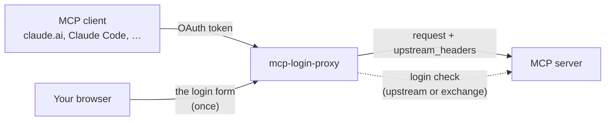

# How it works



The client only ever holds the proxy's OAuth tokens. On every request the proxy renders the config file's `upstream_headers` from that login and forwards the request.

## Login

```mermaid
sequenceDiagram
  participant C as MCP client
  participant B as Browser
  participant P as Proxy
  participant S as MCP server
  C->>P: POST /mcp (no token)
  P-->>C: 401, resource metadata
  C->>P: register, then send the browser to /authorize
  B->>P: the form
  P->>S: check (upstream or exchange; users is checked by the proxy)
  S-->>P: accepted (and a token, for exchange)
  P-->>B: redirect with code
  C->>P: /token (code)
  P-->>C: OAuth access and refresh token
```

The login comes from [mcp-login-oauth](https://github.com/Marceltov/mcp-login-oauth), a small OAuth 2.1 server for MCP servers whose login is a form.

## Requests

Every request to `/mcp` with a valid OAuth token is forwarded unchanged, except that the client's `Authorization` is dropped and the headers from `upstream_headers` are added. Responses stream back as they arrive, so long tool calls and event streams stay open as long as the server keeps them.

The one exception is the `initialize` answer: with `instructions` set, the proxy adds them. Only that small response is read whole.

## Why configuration, not code

Every MCP server needs a slightly different login, but the OAuth side, the forwarding and the store are the same. With the differences in one file, a new server needs a config file and no release. The decision is recorded in [ADR 0003](https://github.com/Marceltov/mcp-login-proxy/blob/main/docs/adr/0003-a-general-login-front-configured-per-deployment.md).
